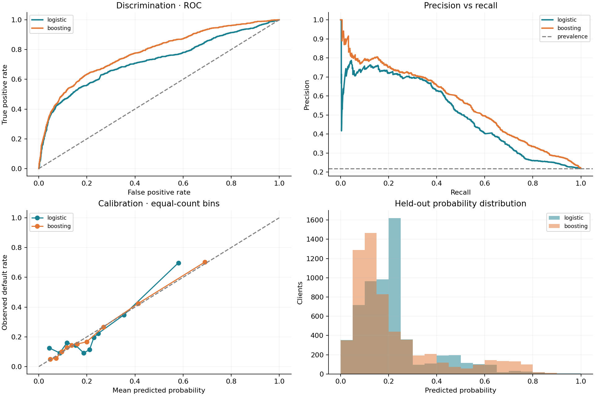

# Credit Risk Prediction & Model Validation

An original Python/SQL portfolio study of **behavioral credit-card default prediction**, with leakage-aware evaluation, independent report reconciliation and drift monitoring. Designed around the development, validation, monitoring and reporting skills in a risk-model analyst internship. No affiliation with Citi; no proprietary bank data.



## Measured results

Fixed seed 42; 30,000 public UCI records; 17,975 training / 6,015 validation / **6,010 test** observations. Model selection used validation ROC-AUC, before test evaluation.

| Model | Test ROC-AUC | PR-AUC (average precision) | KS | Brier ↓ | ECE (10 bins) ↓ |
|---|---:|---:|---:|---:|---:|
| Logistic regression | 0.7223 | 0.5043 | 0.3746 | 0.1439 | 0.0469 |
| Calibrated histogram gradient boosting | **0.7795** | **0.5574** | **0.4355** | **0.1327** | **0.0114** |

Boosting ROC-AUC 95% cluster-bootstrap interval: **[0.7654, 0.7944]**, 300 replicates. Test default prevalence: 21.86% (the constant-score AP benchmark). These are measured results, not performance targets or expected production outcomes. No tuning followed inspection of test results.

Open `reports/index.html` locally for the complete self-contained report. GitHub displays its source rather than executing HTML; the chart above and [machine-readable results](reports/results.json) are directly viewable. [Validation memo](docs/model-validation.md) explains the decision and limitations.

## Reproduce

Python 3.13 is the measured environment. From the repository root:

```bash
python -m venv .venv
# Windows PowerShell: .venv\Scripts\Activate.ps1
# macOS/Linux: source .venv/bin/activate
python -m pip install -r requirements-lock.txt
python -m pip install -e . --no-deps
python -m pytest -q
python -m credit_risk.pipeline
```

The first run downloads the original XLS archive directly from UCI (no Kaggle credentials), verifies its pinned SHA-256, validates schema/IDs/labels, and creates all reports. Subsequent runs verify the cached file. A mismatch stops execution; never bypass it without investigating the upstream source. Internet is required only for dependency installation and the first dataset download. Typical execution is a few minutes, depending on hardware.

Outputs:

- `reports/`: portable HTML, validation chart, metrics JSON, segment/subgroup diagnostics, drift and importance CSVs.
- `artifacts/`: local SQLite database, held-out predictions and split manifest. Ignored by Git.
- `data/raw/`: checksum-pinned source archive. Ignored by Git; attribution remains in [SOURCES.md](SOURCES.md).

Run `python -m credit_risk.pipeline --bootstrap 1000` for a larger bootstrap. This changes interval estimates and report metadata; it does not retrain different model specifications. Exact floating-point results may vary across library/hardware versions. `requirements-lock.txt` records the tested numerical environment.

## Design and leakage controls

1. **Prediction moment:** after September 2005 account history is known, predict the next-month default label. Historical bill amounts, repayments and status are legitimate for this behavioral task, but not for a new applicant without history.
2. **Feature allowlist:** 19 account-history features. Exclude ID, target, sex, age, education and marital status. Demographics are retained only for diagnostics; proxy effects remain possible.
3. **Duplicate-aware split:** group identical predictor vectors, even with conflicting labels; use five stratified group folds for roughly 60/20/20 partitions. There are 817 repeated predictor rows. No group crosses boundaries. Grouping by predictors is conservative; IDs do not establish longitudinal borrower history.
4. **Training-only fitting:** logistic imputation/scaling inside a pipeline. Fixed boosting configuration; grouped 3-fold training-only sigmoid calibration. No resampling, target encoding, feature selection or test-driven hyperparameter search.
5. **Validation selects; test evaluates:** both predefined candidates receive final test metrics. Cluster-bootstrap AUC uncertainty accounts for duplicate groups, but not retraining uncertainty.
6. **Integrity:** explicit SQL joins, CTE and aggregation independently reconcile row count, defaults, observed/predicted rates and Brier with pandas. Unknown IDs and duplicate prediction keys fail closed.

This is **not out-of-time validation**: the dataset supplies a single historical cohort. Random splits cannot estimate temporal generalization. No fabricated dates, future outcomes, expected losses or regulatory-compliance claims are used.

## Monitoring

PSI compares validation-reference distributions against held-out distributions and an explicitly **synthetic covariate-shift scenario**. Quantile edges are fit only on the reference; infinite tails include out-of-range values; a missing bin and pseudocount smoothing keep the statistic defined. Constant reference features receive a narrow central bin.

The synthetic case reduces limits by 30% and increments repayment-status codes by one. This is an intentionally simple monitoring demonstration, not a macroeconomic stress model. Do not interpret its probabilities as validated forecasts; counterfactual labels are unavailable. A PSI above 0.10 prompts review and above 0.25 prioritizes investigation in the accompanying runbook; neither threshold is a statistical test or universal banking rule.

## Originality and licensing

All project code, tests, SQL, reporting and documentation were written specifically for this project with AI assistance. No repository was forked, relabeled or copied. [scorecardpy](https://github.com/ShichenXie/scorecardpy) (MIT) inspired the scope of credit-scoring metrics; [Evidently](https://github.com/evidentlyai/evidently) (Apache-2.0) inspired reference/current monitoring and reports. Neither is a runtime dependency. Algorithms and metric definitions are standard; the contribution is the integrated implementation and validation evidence, not a novel statistical method.

Original code: MIT. Dataset: **CC BY 4.0**, Yeh (2009), DOI [10.24432/C55S3H](https://doi.org/10.24432/C55S3H). See [source and attribution details](SOURCES.md).

## Repository map

```text
src/credit_risk/  ingestion, split contract, metrics, pipeline and report
sql/             independent portfolio and segment reports
tests/           metric oracles, drift edge cases, split isolation, integrity checks
reports/         verified run artifacts (aggregates only)
docs/            validation memo, monitoring runbook, interview guide
.github/         lightweight CI tests (no external dataset download)
```

For a walkthrough and honest resume wording, read [the interview guide](docs/interview-guide.md). The model is a portfolio benchmark, not a deployable credit policy or a CECL/CCAR implementation.
